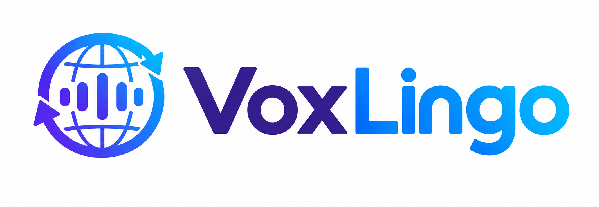

<div align="center">



# VoxLingo

**Speak, translate, listen, and revisit your conversations.**

A cross-platform Flutter translator with a small PHP API and an on-device translation history.

   

</div>

## Features

| Experience | What it does |
| --- | --- |
| Voice input | Records speech and turns it into editable text through the speech-to-text API. |
| Text translation | Translates typed or transcribed text between the selected source and target languages. |
| Spoken output | Synthesizes and plays translated speech. |
| Language controls | Choose languages and swap the source and target. |
| Local history | Saves recent translations on the device with Drift and SQLite; entries can be revisited or removed. |
| Everyday tools | Copy results, clear input, and use the responsive layout on desktop, mobile, or web. |
| Demo modes | Exercise speech recognition, translation, and speech output independently without a live API key. |

The interface supports right-to-left text where appropriate. The PHP service does not need a server-side database; translation history stays in the Flutter client's local database.

## How it works

```text
Flutter client ── HTTPS ──> PHP API ──> AI speech / translation services
      │
      └── Drift + SQLite: local translation history
```

The Flutter app lives in `lib/`. The PHP API entry point is `backend/index.php`; it exposes speech transcription, text translation, and speech synthesis endpoints. The client receives text or audio results and manages its own playback and history. The API key belongs in a server-side `keys.env` file and is never compiled into the Flutter app.

### Requirements

- A Flutter SDK compatible with the Dart constraint in `pubspec.yaml`.
- PHP 8.2 or newer with `curl` and `mbstring` for the real backend.
- An API key for live AI features. **No key is needed for the mock demo.**

## Try the mock demo

From the project root:

```powershell
flutter pub get
flutter run -d chrome --dart-define=STT_MOCK_MODE=true --dart-define=TRANSLATION_MOCK_MODE=true --dart-define=TTS_MOCK_MODE=true
```

Each mock flag can be enabled separately. Mock responses are for interface demonstrations and local development; they are not live translations.

## Run with the PHP API

1. Copy `keys.env.example` to `keys.env` in the project root.
2. Set `OPENAI_API_KEY` in the local `keys.env`. Leave the three mock flags set to `false` for live requests. Keep this file private; it is excluded by `.gitignore`.
3. Start the PHP development server:

   ```powershell
   php -S 127.0.0.1:8080 -t backend backend/index.php
   ```

4. In another terminal, run Flutter and point it to the API:

   ```powershell
   flutter pub get
   flutter run -d windows --dart-define=BACKEND_BASE_URL=http://127.0.0.1:8080/
   ```

Replace `windows` with an available Flutter device. For an emulator or physical device, use an API address reachable from that device; `127.0.0.1` refers to the device itself. The web build can also discover a sibling `backend/` directory when no explicit `BACKEND_BASE_URL` is supplied. `BACKEND_BASE_URL` and the client mock flags are Flutter build-time values. Do not pass `keys.env` to `--dart-define-from-file`.

The API routes are `POST /services/stt/transcribe`, `POST /translation`, and `POST /services/tts/synthesize` when the PHP server uses `backend/` as its document root. See `backend/index.php` for request validation and response formats.

## Build and deploy the web app

The PowerShell helper packages Flutter web output, the PHP backend, and Apache rules into a ZIP under the ignored `build/` directory:

```powershell
.\tool\build_hostinger.ps1 -BaseHref '/apps/voxlingo/'
```

Set `BaseHref` to the path where the site will actually be hosted. For a different subdirectory, also update `RewriteBase` in the root `.htaccess` and `backend/.htaccess` to match that path. Deploy the package to an Apache/PHP host and create `keys.env` on the server from `keys.env.example`; the packaging script does not include the real key file. Verify that the server denies direct access to `keys.env`, serves `sqlite3.wasm` with the correct MIME type, and supports the headers in `.htaccess` required by the web SQLite worker.

Use HTTPS for a public deployment. Protect the paid API endpoints with access controls and rate limits suited to your deployment before opening them to untrusted traffic.

## Checks

```powershell
flutter analyze
flutter test
php -l backend/index.php
php backend/index.php --test
```

The PHP self-test uses fake transports instead of calling a paid API. Flutter's test suite is in `test/`.

## Repository layout

| Path | Purpose |
| --- | --- |
| `lib/` | Flutter screens, client logic, styling, and local persistence. |
| `backend/` | PHP API and Apache routing. |
| `web/` | Web shell and SQLite/Drift worker assets. |
| `assets/branding/` | VoxLingo branding. |
| `tool/build_hostinger.ps1` | Web and backend deployment package builder. |
| `keys.env.example` | Configuration template with no live credentials. |

## License and media

The source code is available under the [MIT License](LICENSE). Artwork, branding, and screenshots have separate rights described in [MEDIA_RIGHTS.md](MEDIA_RIGHTS.md). Third-party packages and media retain their respective licenses and ownership.
